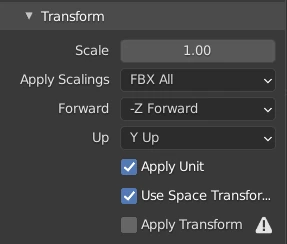
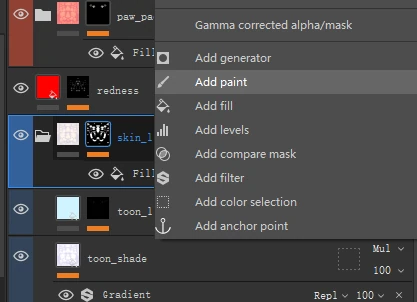

# 가져오기 가이드

[English](install.md) | [日本語](install.ja.md) | **한국어** | [简体中文](install.zh-CN.md)

## VRChat 프로젝트

### 핵심 의존성 컴포넌트

#### Unity 2022.3.22f1

> 본 프로젝트가 의존하는 Unity 에디터 버전

#### VRChat Creator Companion (VCC)

> VRChat 공식 툴로, VRChat Unity 프로젝트의 Editor 와 관련된 각종 SDK 를 한곳에서 관리할 수 있어 직접 처리하는 것보다 간편합니다

<https://vcc.docs.vrchat.com/guides/getting-started>

#### Modular Avatar

> 비파괴 방식으로 의상과 소품을 장착하는 데 사용됩니다. 많은 의상·소품 제작자가 이 툴을 사용하므로, 구매한 prefab 을 아바타에 그대로 끌어다 놓으면 바로 사용할 수 있습니다.

<https://modular-avatar.nadena.dev/docs/intro> (VCC 를 통한 설치를 권장합니다)

> [!WARNING]
> 본 프로젝트의 pw_outfit (prefab) 과 pw_pudding_root (prefab) 은 Modular Avatar 컴포넌트를 통해 업로드 시 관련 animator, parameter, menu 를 pw_core (prefab) 로 자동 병합합니다. 설치하지 않으면 업로드에 성공하지 못합니다.

필요에 따라 pw_outfit (prefab) 또는 pw_pudding_root (prefab), 또는 둘 다를 아바타에서 제거할 수 있습니다

> play mode 로 바로 들어가면 의상이 아바타에 장착되어 있지 않은 것을 볼 수 있습니다. VCC 를 통해 Gesture Manager 를 설치하면 play mode 에서도 Modular Avatar 가 적용됩니다.

#### lilToon Shader

> VRChat 의 툰 재질에 흔히 쓰이는 Shader 입니다

<https://lilxyzw.github.io/lilToon/> (VCC 를 통한 설치를 권장합니다)

> [!WARNING]
> 본 프로젝트의 머티리얼은 lilToon shader 를 사용합니다. 설치하지 않으면 머티리얼이 보라색으로 표시됩니다.

### 권장 컴포넌트 (선택 사항)

#### GogoLoco

> 아바타에 재미있는 locomotion 포즈와 편리한 비행 기능 등을 추가합니다

GogoLoco 는 VRCFury 에 의존합니다. VRCFury 는 Modular Avatar 와 유사한 자동 장착 툴입니다. VRCFury 와 GogoLoco 를 프로젝트에 추가하고, GogoLoco-VRCFury (Prefab) 를 아바타에 추가합니다

<https://vrcfury.com/download> (VCC 를 통한 설치를 권장합니다)
<https://gogoloco.net/> (VCC 를 통한 설치를 권장합니다)

#### VRCFaceTracking-Templates (Jerry's templates)

> 페이스 트래킹을 지원하는 헤드셋이 있다면, 이 컴포넌트로 아바타를 손쉽게 페이스 트래킹에 대응시킬 수 있습니다

VRCFaceTracking-Templates (Jerry's templates) 를 다운로드하고, "VF_ARKit_VRCFT" 를 모델에 끌어다 놓습니다
<https://github.com/Adjerry91/VRCFaceTracking-Templates> (VCC 를 통한 설치를 권장합니다)

PC 에서 VRCFaceTracking 을 실행해, 헤드셋의 페이스 트래킹 데이터를 OSC 로 변환하여 VRChat 안의 아바타를 구동합니다
<https://docs.vrcft.io/docs/intro/getting-started>

## VRM 프로젝트

다운로드 파일에 패키징된 VRM 파일이 이미 포함되어 있습니다. 새로운 VRM 파일을 내보내려면 프로젝트에 UniVRM 0.x 를 추가해야 합니다
<https://github.com/vrm-c/UniVRM/releases>

## FBX 내보내기

내보내기 설정은 VRChat 공식 문서의 설정 가이드(Step 3 - Get the model into your project)를 참고하세요
<https://creators.vrchat.com/avatars/creating-your-first-avatar/>

- pw_base.fbx: Blender 파일에서 armature 의 outfit 본 컬렉션(bone collections)에 있는 본을 모두 삭제한 뒤, armature 와 body 를 선택해 내보냅니다
- pw_outfit.fbx: Blender 파일에서 armature 를 armature_outfit 로 이름을 바꾼 뒤, armature_outfit 과 해당 의상 메시 오브젝트를 선택해 내보냅니다

## Substance Painter 텍스처

이 SP 프로젝트의 레이어 마스크는 보통 SP 프로젝트로 가져온 texture 애셋을 참조하는 것이며, 그려서 만든 것이 아닙니다

편집하려면 마스크를 오른쪽 클릭하고 Add Paint 를 선택하면, Fill(참조하는 texture 애셋) 위에 덮이고, 그다음 Paint 레이어에서 그려 편집할 수 있습니다

